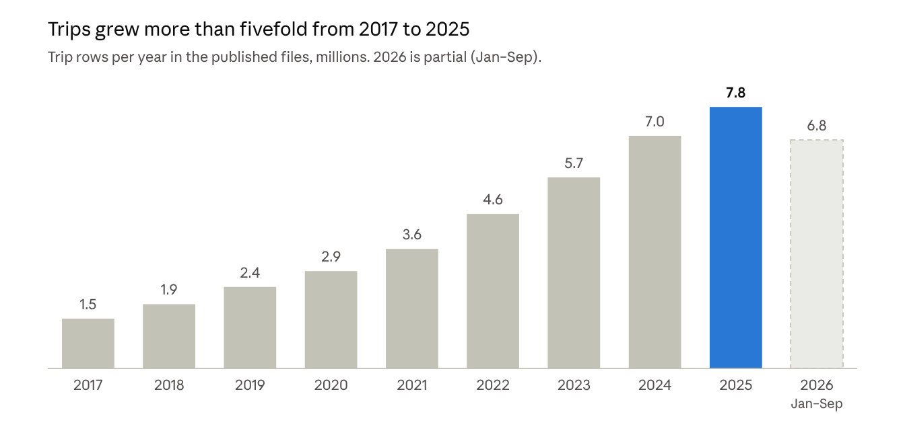

# Visualizing Toronto Bike Share Ridership Data on a Map

As of 2026-11-01

## Overview

The dataset is anonymized, trip-level Bike Share Toronto data from 2014 to 2026. Every row is one trip with a start station and an end station, so it maps naturally as points (stations) and lines (trips between them).

| Attribute | Value |
| --- | --- |
| Publisher | Toronto Parking Authority, via the City of Toronto Open Data Portal |
| License | Open Government Licence – Toronto |
| Coverage | 2014 to 2026 (current year updated in place) |
| Refresh | Monthly; last refreshed 2026-10-27 |
| Formats | XLSX (2014–2016, readme), ZIP of CSVs (2017 onward) |
| Spatial data in the files | Station IDs and names only; no coordinates after 2015 |

Source: [dataset page](https://open.toronto.ca/dataset/bike-share-toronto-ridership-data/), [CKAN API metadata](https://ckan0.cf.opendata.inter.prod-toronto.ca/api/3/action/package_show?id=bike-share-toronto-ridership-data).

## What's in the data

There are 13 downloadable resources: a readme workbook, one file per year from 2016 to 2026, and a combined 2014–2015 file. The schema changes four times, so plan a normalization step before mapping.

| Years | Files | Grain | Columns | Station coordinates |
| --- | --- | --- | --- | --- |
| 2024–2026 | 2024 and 2026: one CSV each (~950 MB). 2025: 12 monthly CSVs | Trip | `Trip_Id`, `Trip_Duration` (s), `Start/End_Station_Id`, `Start/End_Time` (ISO), `Start/End_Station_Name`, `Bike_Id`, `User_Type` (Member / Casual), **`Bike_Model`** (ICONIC, EFIT, EFIT G5, ASTRO) | No |
| 2019–2023 | Quarterly CSVs for 2019, monthly CSVs for 2020–2023 | Trip | `Trip Id`, `Trip  Duration`, `Start/End Station Id`, `Start/End Time` (MM/DD/YYYY HH:MM), names, `Bike Id`, `User Type` (Annual Member / Casual Member) | No |
| 2017–2018 | Quarterly CSVs | Trip | `trip_id`, `trip_duration_seconds`, `from/to_station_id`, `trip_start/stop_time` (M/D/YYYY H:MM), names, `user_type`. No bike ID | No |
| Jul–Dec 2016 (Oct 2015 – Jun 2016 not published) | XLSX with Q3 and Q4 sheets (586 K trips) | Trip | `trip_id`, start/stop time, duration, `from/to_station_name`, `user_type`. No station IDs | No |
| Oct 2014 – Sep 2015 | XLSX, one sheet per month | Aggregated origin–destination counts | Start/End Terminal, Casual, Registered, Total; plus a Station Key sheet, hourly weekday/weekend totals and member postal codes (FSA) | **Yes**, for about 80 stations |

*Row counts of every CSV in the 2017–2026 zip files, counted 2026-11-01. 2016 (Jul–Dec only, 586 K) and 2014–2015 (aggregated counts) are not comparable and are left out.*

| Year | Trips |
| --- | --- |
| 2017 | 1,492,369 |
| 2018 | 1,922,955 |
| 2019 | 2,439,517 |
| 2020 | 2,911,308 |
| 2021 | 3,575,182 |
| 2022 | 4,620,469 |
| 2023 | 5,713,141 |
| 2024 | 6,953,094 |
| 2025 | 7,812,520 |
| 2026 (Jan–Sep) | 6,830,174 |

Volume grew every year, including 2020. Each recent year is about 7–8 M rows, so pre-aggregation (below) is required for browser maps.

**2026 profile** (Jan 1 – Sep 30, 2026): 6.83 M trips, 68% members, 22% e-bikes (EFIT/ASTRO), 1,098 start stations, 391,647 distinct station pairs. Median trip is 11.75 min. Ridership peaks at 17:00 and in July–August, at about 1.26 M trips a month.

**Quirks that affect maps:**

- **2017 Q3–Q4 and 2016 have names but no station IDs.** Join on station name, which is fuzzy because spellings drift ("Fort York  Blvd" with a double space, "St." vs "St").
- **The 2025 `End_Station_Name` column is wrong.** In a 21,825-row sample from July 2025, it always matched the start name even though the end IDs differed. Use `End_Station_Id` only.
- **2016 Q4 dates have day and month swapped** (Oct 1 is stored as Jan 10).
- **2022–2023 have `NULL` station names** for newer stations; the ID is still there.
- **Missing ends and outliers:** 12,951 trips in 2026 have no end station, and durations run up to 30 days (2,592,863 s). Filter out trips that are 0 s, under 60 s with the same start and end station, or over a few hours.
- **Encoding and format:** some CSVs start with a UTF-8 BOM and some don't. The 2022 file nests November as a zip inside the zip. Date formats differ by era.
- **Round trips:** 3.3% of 2026 trips start and end at the same station. They have no direction, so show them as station-level points, not lines.

## Joining trips to the map

Trip files carry only station IDs, so every map starts by joining them to the live GBFS feed's [station_information](https://tor.publicbikesystem.net/ube/gbfs/v1/en/station_information), which gives each station's lat/lon. As of 2026-11-01, the feed lists 1,073 stations (IDs 7000–8274) with 20,815 docks in total.

| GBFS field | Map use |
| --- | --- |
| `lat`, `lon` | Station point; endpoints of trip lines |
| `capacity` | Normalize trips per dock; size symbols |
| `physical_configuration` (REGULAR 478, VAULT 437, SMARTMAPFRAME 104, ELECTRICBIKESTATION 51) | Symbolize station type |
| `groups` (East, West, North, South, Toronto Islands, plus neighbourhood names) | Regional filters and aggregation |
| `is_charging_station` (51 stations) | E-bike layer |
| [station_status](https://tor.publicbikesystem.net/ube/gbfs/v1/en/station_status): bikes/docks available, mechanical vs e-bike | Live availability, if you add a real-time layer |

**Coverage gap:** 30 of the 1,101 station IDs used in 2026 trips are no longer in the live feed. They touch 201,271 trips (2.9%), so older years will have more gaps. To fill them, use the 2014–2015 Station Key sheet, an archived GBFS snapshot, or geocode the station name, which is usually an intersection.

**Pipeline:** read all eras → normalize column names, user types and timestamps → drop bad trips → join station ID to coordinates → write Parquet. Then pre-aggregate by station, by station pair × hour, and by H3 cell before anything reaches the browser. A full year (about 7 M rows) is too much to draw raw, except in WebGL trip layers.

## Ways to map it

The data supports 14 distinct map types, grouped by the geometry they draw: station points, flow lines, area surfaces, and movement through time. All of them come from the same trip table joined to station coordinates.

### Stations as points

1. **Proportional symbols.** One circle per station, sized by trips (starts, ends or both) and colored by a second measure such as % casual or % e-bike. Normalize by `capacity` to compare busy and small docks. This is the simplest useful first map.
2. **Net flow (imbalance) map.** Color each station on a diverging scale by departures − arrivals for a time window. In the morning, residential areas show net-out and the core shows net-in, and the evening reverses it. A slider for 06:00–10:00 vs 16:00–19:00 makes the flip obvious.
3. **Station drill-down (spider map).** Click a station to draw lines to every destination, weighted by count, with a sidebar of top destinations, hourly profile and member split. This works well as the detail view behind any other map.
4. **Network growth.** Plot each station at the date of its first trip, then animate from 2017 to 2026. This shows the system's spread from downtown into the inner suburbs.

### Trips as lines

5. **Origin–destination arcs.** One arc per station pair, width or opacity by count, colored by direction (source to target gradient). With 391 K pairs a year, show only the top 1–5% or filter to one station or area.
6. **Clustered flow map.** Pairs are merged into larger clusters at low zoom and split back into stations as you zoom in, so the map stays readable at city scale. [flowmap.gl](https://github.com/visgl/flowmap.gl) and [flowmap.blue](https://www.flowmap.blue/) handle this directly from a locations table plus a flows table.
7. **Routed corridor volumes.** Route each station pair along the street network with a bike profile in OSRM, Valhalla or GraphHopper. Multiply by trip count and sum per street segment. The result is an estimate of which streets carry bike-share traffic, ready to overlay on the City's cycling network. Routes are inferred, not tracked, so label them as estimates.
8. **Rebalancing moves.** Order trips by `Bike_Id` and time. When a bike's next start station differs from its last end station, a truck or valet moved it. Mapping these jumps shows the operator's rebalancing flows. This needs `Bike_Id`, which is available from 2019 onward.

### Areas as surfaces

9. **Hexbin / H3 grid.** Aggregate starts or ends into H3 cells (resolution 8–9 suits city blocks). Flat color works for comparisons and 3D extrusion for impact. Cells also make different years comparable when stations move.
10. **Heatmap (kernel density).** A smooth density surface of trip starts. It reads well at a glance but hides exact values, so use it as a backdrop, not for comparisons.
11. **Choropleth by neighbourhood or ward.** Spatial-join stations to the City's 158 neighbourhoods or 25 wards, then map trips per resident or per station. Join census population and income to discuss equity of access. Shade areas with no station distinctly so they aren't read as zero demand.
12. **Travel-time surface.** For one origin, color each destination station or cell by median trip duration. This gives a practical isochrone of how far people actually ride in 10, 20 or 30 minutes.

### Movement through time

13. **Animated trips.** Draw each trip as a moving dot from start to end time, along a routed path or a straight line, with a clock. An August 2026 day averages about 41 K trips, which deck.gl's TripsLayer renders smoothly. This is the most striking view for a demo or landing page.
14. **Time-filtered small multiples.** Repeat any map above by hour of day, weekday vs weekend, month, member vs casual, or classic vs e-bike, side by side or behind a scrubber. Comparisons like the summer peak, the 17:00 rush, or island and waterfront casual traffic show up immediately.

## Comparison

Start with symbols, net flow and arcs. They need only per-station and per-pair counts, and they answer most questions. Routing and rebalancing take the most work.

| # | Map type | Question it answers | Aggregation needed | Effort | Library |
| --- | --- | --- | --- | --- | --- |
| 1 | Proportional symbols | Where is demand? | Trips per station | Low | MapLibre circle layer, deck.gl ScatterplotLayer |
| 2 | Net flow | Where do bikes pile up or run out, and when? | Starts − ends per station × hour | Low | MapLibre, deck.gl |
| 3 | Spider drill-down | Where do riders from this station go? | Pairs filtered to one station | Low | deck.gl LineLayer |
| 4 | Network growth | How did coverage expand? | First trip date per station | Low | MapLibre with time filter |
| 5 | OD arcs | What are the dominant trips? | Trips per station pair | Medium | deck.gl ArcLayer |
| 6 | Clustered flow map | What are the citywide movement patterns? | Pairs + location table | Low with flowmap.blue, medium with flowmap.gl | flowmap.blue, flowmap.gl |
| 7 | Routed corridors | Which streets carry the riders? | Routed path per pair, summed per segment | High | OSRM / Valhalla + deck.gl PathLayer |
| 8 | Rebalancing moves | Where does the operator move bikes? | Trips ordered by `Bike_Id` and time | Medium | deck.gl ArcLayer |
| 9 | H3 hexbins | Where is demand, independent of station layout? | Trips per H3 cell | Low | deck.gl H3HexagonLayer, Kepler.gl |
| 10 | Heatmap | Where is it busy, at a glance? | Station points weighted by trips | Low | MapLibre heatmap layer |
| 11 | Choropleth | Which neighbourhoods are served or underserved? | Station → polygon join + census | Medium | MapLibre fill layer, Kepler.gl |
| 12 | Travel-time surface | How far do riders get in N minutes? | Median duration per pair | Medium | deck.gl, MapLibre |
| 13 | Animated trips | What does a day of riding look like? | One day of trips, optionally routed | Medium (high if routed) | deck.gl TripsLayer |
| 14 | Time small multiples | How do patterns shift by hour, season or rider? | Any of the above × time or segment | Low once the base map exists | Any; synced map views |

## Recommended stack and first build

Preprocess offline with DuckDB, then render pre-aggregated files with MapLibre GL plus deck.gl in a Next.js app. DuckDB reads the raw CSVs directly and a full year aggregates in seconds. The browser then loads only small JSON or Parquet files.

| Layer | Choice | Why |
| --- | --- | --- |
| Ingest and clean | Python + DuckDB, written to Parquet | Handles 1 GB CSVs, mixed date formats and BOMs in SQL |
| Station coordinates | GBFS station_information snapshot, saved with the build | Live feed drops retired stations, so freeze a copy |
| Basemap | MapLibre GL with OpenFreeMap or Protomaps tiles | Free and open; no token required |
| Data layers | deck.gl (Scatterplot, Arc, H3Hexagon, Trips) and flowmap.gl | WebGL handles 100 K+ features smoothly |
| Quick exploration | Kepler.gl or flowmap.blue | Drop in a CSV and test map types before building them |

**First build, in order:**

1. Ingest 2024–2026, which share one schema, and join to the GBFS snapshot.
2. Ship maps 1, 2 and 3: station symbols, a net-flow toggle by hour, and click-to-drill-down.
3. Add map 5 (top OD arcs) and map 14's hour and member filters across all layers.
4. Add map 13 (one animated day) as the landing view.
5. Extend back to 2017–2023 with the name-based join, then add network growth and routed corridors.

**Open questions:** which years matter most, whether the audience is the public or planners (that decides between animation and choropleths), and whether a live station_status layer is in scope.

## Sources

- [Bike Share Toronto Ridership Data, City of Toronto Open Data](https://open.toronto.ca/dataset/bike-share-toronto-ridership-data/), including the readme workbook and the 2014–2015, 2016, 2017, 2018, 2025 and 2026 files, which were opened and profiled; all 2017–2026 zips were downloaded for row counts
- [CKAN package metadata](https://ckan0.cf.opendata.inter.prod-toronto.ca/api/3/action/package_show?id=bike-share-toronto-ridership-data)
- [Bike Share Toronto GBFS station_information](https://tor.publicbikesystem.net/ube/gbfs/v1/en/station_information) and [station_status](https://tor.publicbikesystem.net/ube/gbfs/v1/en/station_status), read 2026-11-01
